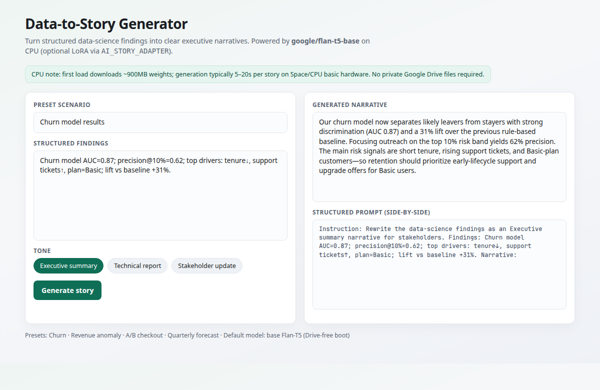

# ai-story — Data Science Findings → Human Narratives

[](https://colab.research.google.com/github/waleedarif1011/ai-story/blob/main/fine_tune_flan_t5_base.ipynb)
[](https://github.com/waleedarif1011/ai-story/actions/workflows/ci.yml)
[](LICENSE)

Fine-tune **Flan-T5-base** with LoRA to turn structured data-science outputs
(metrics, A/B results, EDA summaries) into clear executive narratives — then
serve them from a CPU Gradio demo that boots on the **public base model** (no
private Google Drive files).



## Try live inference

| Mode | How |
|------|-----|
| **Hugging Face Space** | *Not published yet* — no `HF_TOKEN` in this environment. Deploy with [`docs/hf-space-deploy.md`](docs/hf-space-deploy.md); the Live Demo badge will land here once the Space exists. |
| **Local Gradio** | `pip install -r requirements.txt && python app.py` |

The demo ships four presets: **Churn model results**, **Revenue anomaly**,
**A/B checkout test**, and **Quarterly forecast**. Choose a tone
(Executive summary / Technical report / Stakeholder update) and inspect the
structured prompt next to the generated story.

**CPU latency (honest):** first boot downloads public `google/flan-t5-base`
(~900MB). After load, expect roughly **5–20 seconds per story** on Space CPU
basic / a typical laptop. Optional LoRA: set `AI_STORY_ADAPTER` to a local path
or **public** Hub repo ID (never required for boot).

## Fine-tune your own adapter

| Mode | How |
|------|-----|
| **Colab notebook** | [](https://colab.research.google.com/github/waleedarif1011/ai-story/blob/main/fine_tune_flan_t5_base.ipynb) — [`fine_tune_flan_t5_base.ipynb`](fine_tune_flan_t5_base.ipynb) defaults to the committed sample JSONL |
| **Local CLI** | `python -m src.train_lora --data data/sample_ds_stories.jsonl --epochs 3` |

```bash
pip install -r requirements.txt
python -m src.train_lora --output-dir adapters/flan-t5-base-lora
python -m src.inference "AUC=0.87; lift +31%" --adapter adapters/flan-t5-base-lora
```

LoRA defaults match the notebook: `r=8`, `alpha=16`, targets `q/k/v`, task `SEQ_2_SEQ_LM`.

## Sample dataset (no Google Drive)

Committed sample: [`data/sample_ds_stories.jsonl`](data/sample_ds_stories.jsonl)
— **25** curated pairs. The notebook and `src/train_lora.py` both default here;
override with `DATASET_PATH` / `--data` only if you have a larger private file.

| Field | Description |
|-------|-------------|
| `complex_data_science_result` | Structured metrics / EDA / experiment summary |
| `human_storytelling_narrative` | Executive-ready narrative paragraph |

### Before → After examples

| Structured findings (before) | Narrative (after) |
|------------------------------|-------------------|
| Churn model AUC=0.87; precision@10%=0.62; top drivers: tenure↓, support tickets↑, plan=Basic; lift vs baseline +31%. | Our churn model now separates likely leavers from stayers with strong discrimination (AUC 0.87) and a 31% lift over the previous rule-based baseline… |
| Revenue anomaly week 42: −18% vs 8-week MA; Electronics −27%; West −22%; payment failures +9pp. | Week 42 revenue fell 18% below the eight-week moving average, concentrated in Electronics and the West… pointing to a checkout or processor issue… |
| A/B checkout: variant B; n=42k; conversion 3.4%→3.9%; +14.7%; p=0.008. | Checkout variant B lifted conversion from 3.4% to 3.9% (+14.7% relative) across 42,000 sessions with a statistically significant result… |
| Q3 forecast: $12.4M (80% PI $11.1–$13.6M); MAPE 6.2%; new logo +$1.1M; churn −$0.4M. | The Q3 revenue forecast centers at $12.4M with an 80% prediction interval of $11.1–$13.6M… |

## Repository layout

```
app.py                      # Gradio Data-to-Story Generator (Drive-free boot)
assets/data-to-story-demo.png
data/sample_ds_stories.jsonl
src/prompts.py              # Instruction prompt templates
src/inference.py            # CPU Flan-T5 (+ optional LoRA) generation
src/train_lora.py           # CLI LoRA fine-tune on JSONL
fine_tune_flan_t5_base.ipynb
tests/test_prompts.py
docs/hf-space-deploy.md
```

## Tests

```bash
pip install -r requirements.txt
python -m pytest -q
```

CI runs the same suite on every push/PR (`.github/workflows/ci.yml`). Inference
tests are mocked so CI stays CPU-light and does not download model weights.

## Limitations

Base Flan-T5 without a task-specific adapter produces generic paraphrases.
Fine-tune on your own JSONL (or the sample file) for domain voice. Narrative
quality scales with dataset size and diversity. Space cold-start downloads the
public base weights; keep adapters optional and public if you publish one.
